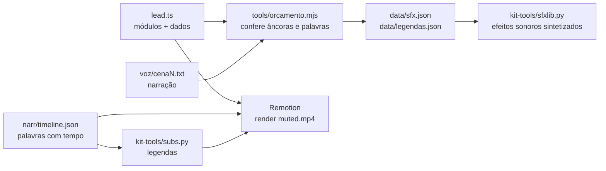

# personalized-video-pipeline

Base [Remotion](https://www.remotion.dev) para gerar **vídeos verticais (1080x1920) personalizados por lead**: você descreve o lead e as cenas em um único arquivo (`video/src/lead.ts`), escreve a narração em `voz/cenaN.txt`, e o vídeo é montado a partir de **módulos de cena reutilizáveis** (reputação, mapa, busca, anúncios, convite...) sincronizados com a fala por **âncoras de texto**.

> O exemplo incluído é 100% fictício (empresa "Café Aurora", decisora "Carla"). Não há áudio, voz, imagem ou texto comercial de nenhum negócio real, e nenhuma chave de API.

## Como funciona



- **Âncoras**: toda chave `em` (ou terminada em `Em`) no `lead.ts` é uma frase que precisa existir na narração da cena. O módulo entra quando a frase é falada. `orcamento.mjs` falha se alguma âncora não for encontrada, e conta palavras por cena contra a faixa de cada módulo.
- **Tema por lead**: cores e fonte vêm de `LEAD.tema`.
- **Efeitos sonoros**: `kit-tools/sfxlib.py` sintetiza cliques, "pops" e sinos (numpy), sem arquivos de áudio.
- **Legendas**: `kit-tools/subs.py` transforma a timeline de palavras em legendas de até 2 linhas, trocando "falado → escrito" (números).

## Estrutura

```
video/            projeto Remotion (src/core, src/scenes/modules, src/parts, src/lead.ts)
voz/              textos de narração por cena (exemplo)
tools/            orcamento.mjs (conferência de âncoras e palavras)
kit-tools/        subs.py, sfxlib.py, produzir.ps1
```

Módulos de cena disponíveis (`video/src/scenes/modules`): `buscaPeloNome`, `centralTransparencia`, `comparativoCategorias`, `custoDoClique`, `dicas`, `frase`, `heatmapGrade`, `mapaCidade`, `patrocinadosNaBusca`, `semAnuncios`, `variacaoEntreRodadas`, entre outros. Cenas fixas: `abertura` e `convite`.

## Uso

```bash
cd video && npm install && cd ..
node tools/orcamento.mjs                   # confere o lead.ts contra voz/cenaN.txt
cd video && npx remotion studio src/index.ts   # pré-visualização
```

```powershell
.\kit-tools\produzir.ps1 -Etapa contar
.\kit-tools\produzir.ps1 -Etapa ancoras
.\kit-tools\produzir.ps1 -Etapa tipos
.\kit-tools\produzir.ps1 -Etapa render
```

### Voz

A geração de voz (TTS) **não** está incluída. Gere `voz/cenaN.mp3` com o provedor que preferir, monte `narr/timeline.json` (lista de palavras com `start`/`end` e cena) e `video/public/narracao.wav`, e então rode `-Etapa legendas` e `-Etapa render`. Nunca coloque chaves de API no repositório.

## Para criar um novo vídeo

1. Edite `LEAD` e `CENAS` em `video/src/lead.ts`.
2. Escreva `voz/cena1.txt`, `cena2.txt`... com as frases-âncora.
3. Rode `orcamento.mjs` até ficar `orçamento ok`.
4. Gere voz e timeline, rode `legendas` e `render`.

## Licença

MIT
